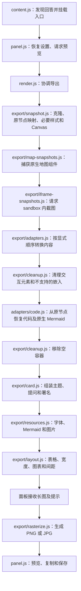

# 导出架构

本项目把 ChatGPT 单条回答的当前内容和交互状态转换为静态长图。组件兼容逻辑与面板、资源加载、排版和图片输出分别维护。

## 处理流程



## 模块边界

| 模块 | 职责 | 约束 |
| --- | --- | --- |
| `chatgpt/selectors.js`、`dom.js` | 回答、提问、生成状态及操作栏识别 | 宿主回答选择器集中维护；组件内部选择器归相应适配器 |
| `render.js` | 编排导出阶段 | 不添加组件选择器或具体控件转换逻辑 |
| `export/snapshot.js` | 建立 DOM 副本及来源映射；捕获可读取的 Canvas 和数学／SVG 样式 | 不修改原回答；过滤判断基于原 DOM |
| `export/iframe-snapshots.js`、`frame-capture.js` | 在 sandbox 内栅格化当前可视化，再替换副本中的 iframe | 域名、消息来源和请求 ID 校验；不修改原页面；失败沿用嵌入提示 |
| `map-buffer.js`、`export/map-snapshots.js` | 在地图初始化时保留 WebGL 绘制缓冲，导出时把整个地图组件转成 PNG | 仅匹配原生 Mapbox 地图；检查透明缓冲；不移动地图或修改源 DOM |
| `export/adapters.js` | 固定适配顺序 | 适配器在清理按钮前读取原节点的实时属性 |
| `export/adapters/` | 把内容转换为静态 DOM | 不操作面板、不保存设置、不下载资源 |
| `export/cleanup.js` | 移除不应导出的节点、替换嵌入及清理空容器 | 必须保留适配器产生的静态内容 |
| `export/card.js` | 组装长图外观 | 接收转换后的内容，不识别宿主组件 |
| `export/resources.js` | 等待字体、渲染 Mermaid、解码及内联可导出图片 | 保留原有超时与失败提示 |
| `export/layout.js` | 编排已有布局策略 | 测量已挂载且资源已准备的长图 |
| `export/rasterize.js` | 栅格化、倍率限制、圆角与输出格式 | 不修改源回答或导出偏好 |
| `shared/` | 公共颜色判断、选择标记及超时 | 不依赖面板或组件适配器 |
| `styles/` | 长图样式 | 通过 `card.js` 按固定顺序合并；无运行时 CSS 网络请求 |

`src/layout.js` 保存设置校验、宽度限制和测量策略；`src/export/layout.js` 负责在导出阶段调用这些策略。

## 接口与状态

面板继续只调用以下接口：

```js
createCard(answer, options, mount) // Promise<{ card, warnings }>
rasterize(card, options)          // Promise<{ blob, layoutWidth, width, height, reduced }>
```

快照产生的上下文包括：

- `clone`：可修改的 DOM 副本。
- `sourceByCopy`：原副本节点到源节点的映射。
- `omitted`：依据源 DOM 判定排除的节点集合。
- `options`：本次渲染的设置。
- `warnings`：沿用现有本地化提示字符串，最终去重。
- `readStyle`：读取原节点计算样式；测试可以注入替代实现。

原节点只读。`sourceByCopy` 初始涵盖克隆节点；适配器替换外层节点后，如果后续阶段还需要读取原布局，必须为替换节点补充来源映射。其他新生成的静态节点没有来源映射，后续适配器应跳过或按导出标记处理。上下文随单次导出释放，不缓存对话内容。

控件当前值仍在同步适配阶段从原节点读取，Canvas 在克隆时捕获。它们不构成可持久化或完整离线重放的 UI 状态模型。

## 适配顺序与节点归属

1. 测验选项：将纵向 box 中至少两个带边框、行布局且包含 text 的成组 pressable 转为静态行；保留原子节点及反馈图标，为替换行补充来源映射。此步先于操作按钮清理，不按 A/B/C 文案识别，也不保留所有按钮。
2. 图标与视觉元素：在新生成的表单 SVG 出现之前，识别宿主图标，包括测验中的已有反馈图标。
3. 表单：优先转换表单选择项和输入值，替换整个自定义控件，避免重复标记。
4. 清单：只处理仍然存在的勾选控件；已经替换的表单选择项不会再转换。
5. 结构化布局：保留卡片、行、网格、进度形状、实体文字及其他已支持组件的外层布局。
6. 网络图片：保留受支持的代理图片及作者提供的比例、裁切位置和宽度；然后处理被排除的结构化图片占位。
7. 清理交互元素后，从原代码节点生成高亮代码或原生 Mermaid 图片；最后清理空容器。

第 7 步保留历史执行顺序，避免宿主代码工具栏或隐藏节点影响内容提取。数学／SVG 样式及 Canvas 捕获在快照阶段执行。

这是一组明确顺序的函数适配器，没有动态加载或自动优先级系统。新增组件时必须明确其节点归属及与现有步骤的关系。

## 共享控件样式

导出控件的 SVG 结构由适配器生成，外观统一放在 `src/styles/widgets.css`。不要在各转换分支中重复定义相同图标或追加局部样式覆盖。

- select 和日期选择器统一调用 `form-controls.js` 的 `dropdownArrow()`；新增下拉类控件也必须复用此函数，不使用文字字符 `⌄` 代替箭头。
- 箭头统一标记为 `svg[data-export-form-control=arrow]`，尺寸随字号缩放，颜色适配浅色／深色，垂直居中且右侧间距一致。
- 日期左侧图标单独标记为 `calendar`；日历定位规则不能匹配全部日期 SVG，避免覆盖右侧箭头。
- 中性进度填充使用 `data-export-progress-fill` 和导出主题前景色，与轨道保持可辨；彩色背景变量读取计算后的颜色，宽度继续保留原比例，包括 0%。

修改共享组件时，检查所有调用分支，并验证浅色、深色和窄宽度实际 PNG。现有测试检查 select／日期的箭头一致及日历图标独立保留；尚未设置禁止重复图标或文字箭头的构建检查。

## 添加组件支持

1. 在 `samples/intelligent-ui/` 保存真实 DOM、状态说明、页面参考图和实际导出图。
2. 确定稳定的 `data-d-component`、原生标签或 ARIA 属性，不依赖生成的 CSS 类名。
3. 在 `export/adapters/` 添加转换函数；通过上下文读取原状态并生成带 `data-export-*` 标记的静态内容。
4. 在 `export/adapters.js` 注册适配器，并说明顺序与节点归属。代码类内容需要注意其独立转换阶段。
5. 在 `styles/` 添加必要样式。基础 → 组件 → 字号／间距 → 控件及后续组件规则的合并顺序需保持稳定。
6. 为状态丢失、重复转换或清理误删等风险增加有意义的测试；可将真实样本提炼成 `tests/fixtures/`。
7. 运行 `npm test`，再检查浅色、深色、窄宽度与交互后的实际 PNG。

测试维护约定见 [tests/README.md](tests/README.md)。导出集成测试调用真实 `createCard()`，避免在测试内维护另一套阶段顺序。

仅采集样本不会自动接入测试。未知组件当前沿用既有通用清理行为。

## iframe 静态截图

`frame.js` 仅注入 `https://*.web-sandbox.oaiusercontent.com/*`，并在子 frame 中监听来自 ChatGPT 直接父窗口的请求。父端同时校验 iframe 窗口、精确 origin、协议及随机请求 ID；只接受有尺寸上限的 PNG data URL。图片留在单次导出的内存里，不写入 storage 或上传服务器。

快照之后、普通适配和清理之前，`preserveIframeSnapshots()` 将成功捕获的 iframe 副本换成 `img[data-export-iframe-snapshot]`。失败或 25 秒无回应则保留 iframe，让原清理阶段产生提示。源 iframe 不被替换、滚动或重载。

Skybridge 的全宽同源内层 iframe 会逐层读取实际文档（最多五层），避免只截到 sandbox 外壳；其他嵌套 iframe 无法捕获时明确失败。内部文档通过 html-to-image 生成 PNG，字体和原生图片等待就绪，像素总量上限 1600 万、数据长度上限 3200 万字符。该方案是 DOM 栅格化，受字体、资源访问和 Canvas/WebGL 可读取性限制，不保证任意网页的屏幕像素一致。

截图保持当前页面主题和排版，宽度随长图内容等比缩放。`applyImageWidths()` 跳过此标记，避免普通图表大小设置缩小整个页面。导出主题、字号不会改写截图内的内容。

## 原生地图截图

`map-route-gym-eligibility` 和 `ottawa-walking-tour-map` 的地图是主页面上的 `canvas.mapboxgl-canvas`，均没有 iframe。地图所属的 `[data-testid="businesses-map-widget"]` 由单独截图阶段处理，普通 Canvas 继续使用 `snapshot.js`。只调用 `toDataURL()` 未抛错不代表地图像素存在。

`map-buffer-entry.js` 在 ChatGPT 页面 `document_start` 的 MAIN world 运行，包装 `HTMLCanvasElement.getContext()`，仅当 Canvas 匹配 Mapbox 类名且属于 `chatgpt-map-canvas` 时，对 WebGL 请求开启 `preserveDrawingBuffer`。已创建的上下文不能靠后续导出改变这个选项，因此扩展更新后必须刷新对话。其他 Canvas 和参数保持原调用方式；不查找 React 私有状态、不滚动或缩放地图、不注册持续截图任务。保留缓冲存在性能代价，Mapbox 默认关闭此选项是性能优化，见 [Mapbox 文档](https://docs.mapbox.com/mapbox-gl-js/api/map/#map-parameters)。

地图截图在普通适配／按钮清理之前执行，避免编号按钮、`aria-hidden` 地点标签和卡片一起丢失。先在独立 2D Canvas 排除透明或纯黑的清空缓冲，再通过 html-to-image 栅格化整个组件；这不能证明所有瓦片已加载，仍需原页面视觉核对。不支持的交互提示及展开控件被过滤，同源 SVG sprite 引用转换为静态矢量形状。数据源仍是原页面，不重新请求地图瓦片或重建路线。

`scripts/html-to-image-scroll.mjs` 只在调用方设置 `preserveScrollPositions` 时，对克隆节点的子元素施加原滚动位置偏移，保留当前可见卡片和裁切范围。补丁在构建阶段应用，依赖升级时必须复查克隆流程；源节点不被滚动。

成功输出 `img[data-export-map-snapshot]`，不受普通图表大小设置影响。地点缩略图因 CORS／网络失败而无法内联时，`onImageErrorHandler` 只在 html-to-image 的克隆图片上写入自包含占位 SVG，保留地图截图并单独发出缩略图警告。源图片不改动。透明、不可读、必需资源失败或 15 秒超时则将整个地图组件替换为说明并发出警告；控制台记录捕获错误原因。像素量限制沿用 1600 万。以下为 1.3.1 的历史验收记录；1.3.2 的图片读取及开关验证见后文。Ottawa 样本已有真实页面 Save PNG 的浅色 Automatic（1520×1604）和深色 600px（1200×1524）输出，底图、路线、标记、标签与卡片文字恢复；缩略图降级为占位，记录为 partial，并保留历史 fail 材料。另一地图样本待真实复验；测试 WebGL 底色和离线 DOM 验证不能代替实际地图 PNG。

## 构建与清理

构建先清空生成目录 `dist/`，再生成扩展资源，避免旧文件留在安装包中。源代码、样本模板和测试 fixture 不由构建删除。

浏览器临时输出使用 `output/playwright/` 或临时目录，`.playwright-cli/` 与 `output/playwright/` 不提交。验证结束后可以删除复现 HTML／DOM、临时脚本、截图和浏览器日志；需要长期保留的样本放入 `samples/intelligent-ui/`，自动化回归所需 DOM 放入 `tests/fixtures/`。旧发布包在新包校验完成后清理；历史版本说明保留在 `changelog.md`。

2026-10-13 已清理上述浏览器临时目录和项目内的 `.DS_Store`。下文保留历史验证结论，临时 PNG／日志不再随项目保留；正式样本库、测试 fixture、当前构建和发布包未删除。

## 结构化网络图片（1.3.2）

`content-filter.js` 保留结构化 image 组件内的 `https://images.openai.com/static-rsc-*/...` 图片，继续排除生成图片和 favicon。`network-images.js` 将 authored aspect-ratio、width、max-width 和 object-position 转换到导出节点，移除 loading UI；这些图片不受图表尺寸设置影响。

`shared/network-image.js` 通过 runtime 消息向 `image-worker.js` 请求图片。worker 校验发送方为 ChatGPT 主 frame、URL 为唯一允许的 HTTPS 域名及 static 图片路径；匿名无 referrer 请求，禁止重定向，接受 PNG/JPEG/WebP/GIF/AVIF，流式限制 10 MiB，超时 12 秒。收到的 data URL 仅留在当前导出内存，正文图片解码后限制 1600 万像素；失败时仍显示图片占位并警告。地图截图通过 scripts/html-to-image-resources.mjs 的构建补丁传入受限 resourceLoader，复用相同后台通道；每次捕获内按完整 URL 复用结果，读取失败转换为占位并记录界面警告，其他资源保留库的原有行为。

新增 host permission 仅为 `https://images.openai.com/*`。构建输出 image-worker.js 并在 manifest 注册 service_worker；隐私政策同步说明资源请求、权限和临时数据。扩展重载及站点权限生效后，用户提供的三张卡片照片已通过真实 Save PNG 验证，覆盖浅色 Automatic 与深色 600px；该轮临时证据已在项目清理时删除。显示图片开关以 showImages 存储，兼容旧 showImagePlaceholders 偏好；关闭时在资源读取前移除正文照片／占位及地图卡片照片，但地图底图、标记、图表和 iframe 可视化保留。

Show images 历史真实页面验证结果：开启／关闭的实际 Save PNG 分别为 1520×3594、1520×3078，关闭时正文与地图卡片照片消失，地图、标记和文字保留。按本轮开始时间过滤的页面 warning/error 日志为空；旧扩展管理页记录未被自动删除。

## Writing block 适配

`export/adapters/writing-blocks.js` 在普通表单转换之前识别 `[data-oai-writing-block-surface]`／`[data-testid="chatgpt-writing-block"]`，将多行 textbox 编辑器的已快照子节点移动到静态 section。保留 h1/h2、段落、列表、strong、行内 code 和现有来源映射，不使用可能滞后的 data-markdown-copy-text 重建内容。外层编辑 UI、role=textbox 和编辑属性不进入输出；普通输入框继续走表单适配。

`styles/writing-blocks.css` 使用自动高度和标准边框，块间距复用 data-export-flow；内容跟随导出宽度、字体和主题排版，不复制原编辑器的固定高度，也不通过裁切隐藏末尾。完整样本 fixture 验证 9 个标题、33 个列表项、21 处加粗及尾随正文，源 DOM 保持不变。用户提供 DOM 的本地生产栅格化检查覆盖小字号、浅色 760px（1520×5760 PNG）和深色 600px（1200×6280 PNG），格式保留且末行位于边框内；该轮临时 PNG 已在项目清理时删除。用户已于 2026-10-13 确认真实扩展验收通过。

## 栅格化时的文字重排

普通 DOM 与 SVG image 的文字度量可能不同。已复现同一段正文在 DOM 中占两行、转图片后占三行；html-to-image 复制的固定段落高度导致后续文字覆盖。仅取消库的字号缩小处理未能消除此例。

`rasterize.js` 先使用 html-to-image 内联资源并生成 SVG，再由 `svg-layout.js` 在独立的序列化副本中恢复段落、标题、列表、代码块、表格单元格及其祖先容器的自然高度；含文字的网格行也恢复自动高度。图形、数学、图片框、进度形状和静态表单控件保留自己的尺寸。源回答和暂存卡片均不修改。

SVG 在图片上下文中以低分辨率探测实际内容结束位置；双色标记在最终渲染前移除。探测空间不足时在既有画布轴长／像素限制内扩大重试，最终按测得高度重新计算导出倍率并生成 PNG／JPG。不能确认结束位置或超出限制则报错，不按旧 DOM 高度裁切。此流程增加一次 SVG 图片解码和低分辨率绘制，不涉及网络上传。

故障正文的本地生产流程 PNG 已覆盖浅色／深色、760px／600px，760px 输出从旧的 1520×1418 改为 1520×1462，覆盖消失且末尾完整。普通正文与完整长 Writing block 另以 600px 检查，长文档为 1200×6324；末段和边框保留。复现脚本及临时 PNG 使用系统临时目录，不进入项目。用户已于 2026-10-13 确认真实扩展验收通过；1.3.3 发布提交在独立目录构建并通过 99 项测试，其他历史样本的状态保持原记录。
