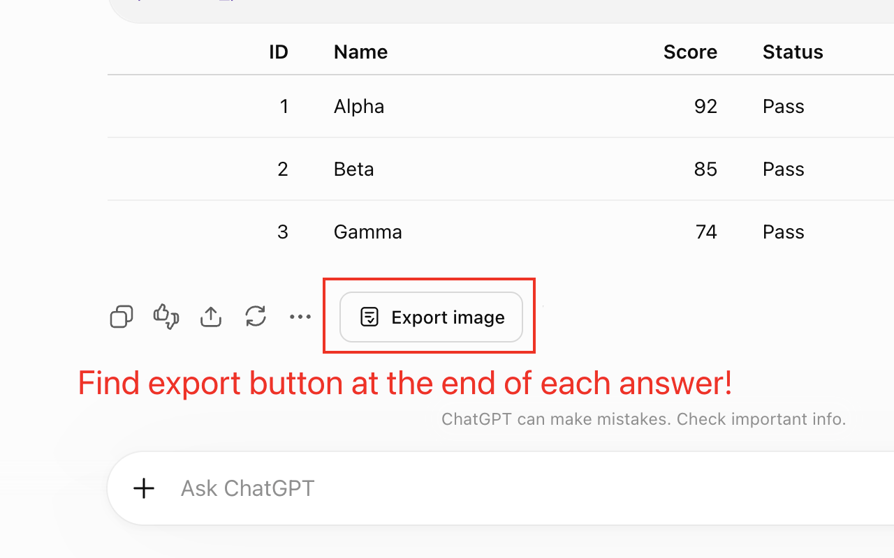
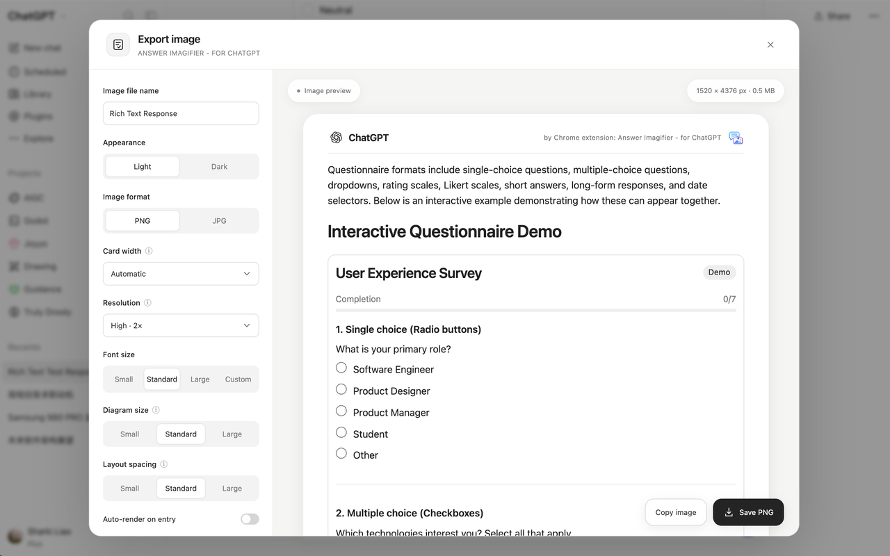
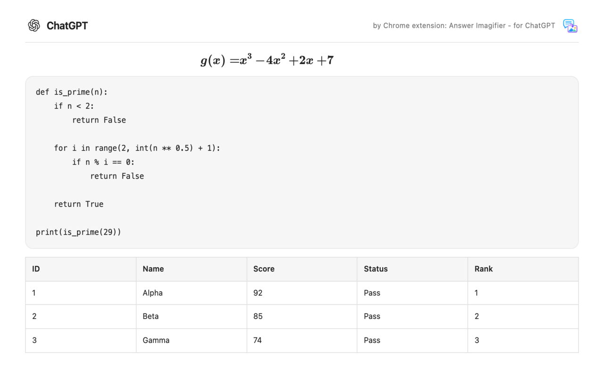

**English** | [简体中文](README.zh-CN.md)

# Answer Imagifier - for ChatGPT

Turn one finished ChatGPT answer into a single clean PNG or JPG. Code highlighting, tables, math, Mermaid diagrams, cards, and supported maps stay in the picture, so you can save or share the whole reply without stitching screenshots.

[](https://chromewebstore.google.com/detail/answer-imagifier-for-chat/llhbppnankbnkddcmhfejoegcembkdfe) [](https://chromewebstore.google.com/detail/answer-imagifier-for-chat/llhbppnankbnkddcmhfejoegcembkdfe) [](https://chromewebstore.google.com/detail/answer-imagifier-for-chat/llhbppnankbnkddcmhfejoegcembkdfe) [](LICENSE)

## Add to Chrome

**[Add to Chrome](https://chromewebstore.google.com/detail/answer-imagifier-for-chat/llhbppnankbnkddcmhfejoegcembkdfe)**

Free on the Chrome Web Store. It runs on [chatgpt.com](https://chatgpt.com) and [chat.openai.com](https://chat.openai.com), and needs Chrome 120 or later. This repository’s manifest is **1.3.6**, the same version as the store listing. Answer Imagifier is an independent extension and is not affiliated with OpenAI.


The animation and the stills below are from an earlier build. The width control is now labeled **Layout width**.

<p>
  
  
</p>



## Features

- Export one finished answer as a PNG or JPG long image, or copy it to the clipboard. Clipboard copies are PNG even when the save format is JPG.
- On a Writing block, **Export block** (to the left of Copy) exports that block alone: headings, paragraphs, lists, bold text, and inline code. The prompt and the rest of the answer stay out of that image. The same block is included when you export the whole answer.
- Keep syntax-highlighted code, tables, math, and Mermaid diagrams. If Mermaid syntax is invalid, the image keeps the source and a short notice.
- Keep structured cards, quizzes, checklists, and form values as they look now. Controls in the image are static. Checklists keep checked and partially checked states, including a nested checkbox sitting beside its label. Segmented controls keep the selected option: a full-width control shares the row evenly across its options, and long labels wrap inside their own segment.
- Keep alignment, declared column widths, spacing, and rounded clipping from the answer. Schedules and stat cards use those declared widths. A photo mixed with an SVG diagram keeps its size, crop, and the card title beside it; loading, action, and source-link overlays on that photo are left out. A standalone diagram still follows the diagram size setting.
- Capture supported ChatGPT sandbox visualizations and native Mapbox maps as still images, scaled to the export width.
- Choose light or dark, automatic or custom layout width (600–1600 px), resolution (1×, 2×, or 3×), font size (including a custom 12–24 px size), diagram size, and spacing.
- Optionally include your prompt, show or hide photos, show or hide the extension credit, and auto-render when the panel opens.
- Output pixel width is layout width × resolution. A 760 px layout at 2× is 1520 px wide. Automatic width follows font size and table content, up to 1600 px. Custom width shows that estimate in the panel.

Very long answers may be rendered at a lower scale so the full image still fits. If it still cannot, export stops with an error and does not crop the answer. Generated images are omitted; use ChatGPT’s own download for those. An answer that is only a generated image, with its status and edit controls, does not get an Export image button. A mixed answer still exports the text around that image.

## How to use

1. **Add the extension** from the Chrome Web Store, then open a conversation on chatgpt.com or chat.openai.com.
2. **Wait until the answer finishes.** Click **Export image** on that answer’s action row, beside ChatGPT’s own controls (including image actions such as Adobe Express). For a Writing block only, click **Export block** beside its Copy button.
3. **Set appearance and layout, then click Start render.** Save PNG or JPG, or copy the image. After you change a setting, render again to refresh the preview. Turn on auto-render if you want that to happen when the panel opens.

The button is on the answer itself, not inside ChatGPT’s share dialog.

## Privacy

Images are rendered locally in your browser. The extension does not upload your conversations, call the ChatGPT or OpenAI API, read cookies, or create public share links.

The only entry under `permissions` is `storage`. It remembers export preferences on this device (theme, format, width, resolution, type size, diagram size, spacing, and the toggles above). Those preferences are not synced through Chrome. Uninstalling the extension removes them. Conversations, custom file names, and generated images are not written to extension storage.

Host access to `https://images.openai.com/*` lets a background worker read supported photos inside structured cards. That request sends the image URL only, without cookies or your answer text. While drawing, Chrome may also load fonts and similar page assets from their original hosts. Those assets are not sent to the extension author.

Details: [Privacy policy](PRIVACY_POLICY.md).

## Install from source / development

`public/manifest.json` in this repository is **1.3.6**. `dist/` and release zips are build output and are not committed.

Node.js 20.19 or later (the lockfile’s packages declare that engine):

```sh
npm ci
npm run build
npm test
```

`npm run build` bundles runtime dependencies into the extension. It does not load scripts from a CDN. `npm test` builds, then runs the Node test suite.

1. Open `chrome://extensions`.
2. Turn on Developer mode.
3. Choose **Load unpacked** and select this project’s `dist` folder.
4. Refresh the ChatGPT tab. After you pull or rebuild, reload the extension and refresh the page again. Map capture needs that refresh so it can run before the map’s WebGL context is created.

A release zip is taken from a tested `dist/` so the archive root contains `manifest.json`. Keep `package.json`, `package-lock.json`, and `public/manifest.json` on the same version, then rebuild:

```sh
(cd dist && zip -r ../v1.3.6.zip . -x '*.DS_Store' '__MACOSX/*')
```

Pipeline, module boundaries, and how to add a component: [Architecture notes](docs/ARCHITECTURE.md) (Chinese). Test layout: [tests/README.md](tests/README.md). Release notes: [changelog.md](changelog.md) (Chinese). `samples/intelligent-ui/` is an optional local sample folder and is gitignored; automated fixtures live in `tests/fixtures/`. Open follow-ups, including an unresolved blank SVG in some dark mixed-content samples, stay in the [Chinese README](README.zh-CN.md).

The in-page UI follows Chrome’s language: English, or Simplified Chinese for any Chinese locale (including Traditional Chinese browser settings). The Web Store listing is published in English, Simplified Chinese, and Traditional Chinese.
