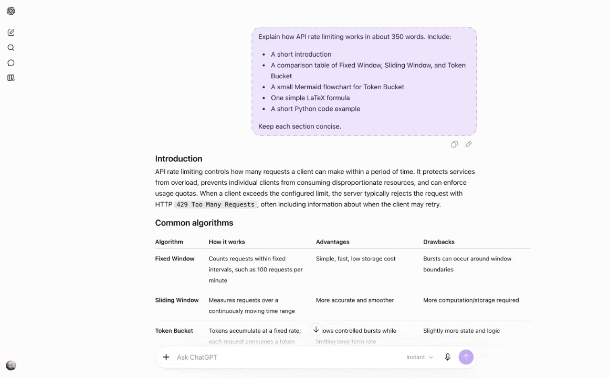
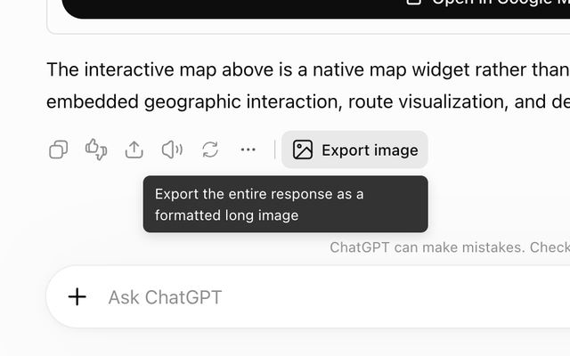
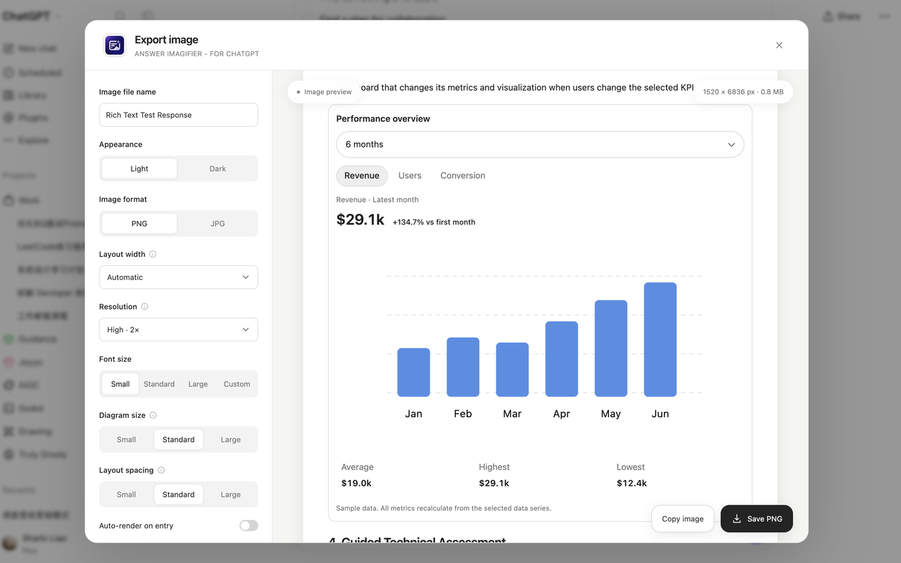

[English](README.md) | **简体中文**

# Answer Imagifier: ChatGPT Long Screenshot & Answer to Image

把 **ChatGPT 单独一条回答或一个 Writing block** 渲染成一张完整的 PNG / JPG 格式化长图。

[](https://chromewebstore.google.com/detail/answer-imagifier-for-chat/llhbppnankbnkddcmhfejoegcembkdfe) [](https://chromewebstore.google.com/detail/answer-imagifier-for-chat/llhbppnankbnkddcmhfejoegcembkdfe) [](https://chromewebstore.google.com/detail/answer-imagifier-for-chat/llhbppnankbnkddcmhfejoegcembkdfe) [](LICENSE)

**[添加到 Chrome](https://chromewebstore.google.com/detail/answer-imagifier-for-chat/llhbppnankbnkddcmhfejoegcembkdfe)**



上面的动图来自更早的版本；下面的截图为当前面板，宽度控件名称为 **Layout width（排版宽度）**。

<p>
  
  
</p>

本仓库 `public/manifest.json` 版本为 **1.3.7**，Chrome 网上应用店审核通过后上架版本随之更新。本版修复嵌套 checkbox 与标签上下堆叠、固定尺寸图标盒居中失效，并更新商店标题与简介。详细内容见 [更新日志](changelog.md)。产品向的英文说明见 [README.md](README.md)。

## 从商店安装

在 Chrome 中打开 [Answer Imagifier](https://chromewebstore.google.com/detail/answer-imagifier-for-chat/llhbppnankbnkddcmhfejoegcembkdfe) 并添加。扩展在 `https://chatgpt.com/*` 与 `https://chat.openai.com/*` 上工作，需要 Chrome 120 或更高版本。

## 从源码安装

从源码安装时，先按下方「构建与测试」生成 `dist/`（构建产物不提交到 Git）。如果已有构建好的 `dist/`，可直接加载。

1. 在 Chrome 地址栏打开 `chrome://extensions`。
2. 打开右上角「开发者模式」。
3. 点击「加载已解压的扩展程序」，选择本项目的 `dist` 文件夹。
4. 刷新 ChatGPT 对话页面。
5. 等回答完成并出现原生操作栏后，点击该回答下方的「Export image / 导出长图」。插件不在 ChatGPT 原生分享弹窗中添加按钮。仅含生成图片的回答（状态、说明和编辑控件）不出现该入口；图文混合回答仍可导出图片以外的正文。
6. 单独导出 Writing block 时，点击区块右上角复制按钮左侧的「Export block / 导出此区块」。悬停或键盘聚焦会立即显示提示；只导出该区块内容，不包含提问和区块外正文。

升级后，重新加载扩展并刷新已打开的 ChatGPT 页面。除了 ChatGPT，扩展现在也在 `https://*.web-sandbox.oaiusercontent.com/*` 的 iframe 内注入截图脚本，用于导出内嵌可视化。地图需要刷新页面，让新增的页面脚本在 WebGL 上下文创建前生效；`storage` 仍只保存本机导出偏好。旧版宽度设置会保留，旧 Compact layout 设置将忽略。

## 功能

- 将单条 ChatGPT 回答导出为完整的 PNG / JPG 长图，或复制 PNG 到剪贴板。
- 保留代码高亮、表格、数学公式、Mermaid 图表和结构化卡片。
- 支持单独导出 Writing block，也可随整条回答一起导出；保留标题、段落、列表、加粗和行内代码；转图片时按重排后的实际高度生成长图，避免换行增加造成文字覆盖或末尾裁切。
- 保留待办列表的完成状态，以及问卷的当前选择和填写内容；互动控件以静态快照呈现，操作按钮不导出。嵌套 checkbox 与标签左右排列，并保留部分勾选。
- 将成组的结构化测验选项转换为静态答案，保留选项内容与已有反馈图标；保留进度填充比例。下拉框和日期选择器共用 SVG 箭头及主题样式。分段控件保留当前选项：整行控件按实际选项数等分，长标签在各自宽度内换行。
- 结构化布局保留来源的对齐、声明宽度、间距和圆角裁切。日程、统计卡按声明宽度排版，避免标签被拆成逐字换行。照片与 SVG 图示混排时保留媒体尺寸、裁切和标题对齐，去掉加载、操作和来源链接浮层；独立图表仍按小／标准／大三档缩放。
- 提供浅色／深色主题，自动／自定义宽度，以及字号、图表尺寸、排版间距和清晰度调整。
- 可选择包含提问、显示／隐藏图片或隐藏扩展署名；实体名称与网格布局保留。
- 先调整设置再生成预览，也可开启进入时自动渲染；修改设置后手动重新生成。
- 图片在本机生成，导出偏好仅保存在本机。

Automatic 会结合字号、表格列数和每列文字宽度选择排版宽度，优先保留短列的可读宽度，长说明正常换行；达到 1600px 上限后仍允许换行。含合并单元格或明确指定列宽的表格保留原布局。

自定义的排版宽度不是最终像素宽度：输出像素宽度 = 排版宽度 × 清晰度倍数。例如 1500px 配合 2× 清晰度，输出为 3000px；自定义模式下会显示预计值，并提醒自定义宽度可能导致排版异常。

## 构建与测试

```sh
npm ci
npm run build
npm test
```

`npm run build` 将全部运行时依赖打包到扩展里，不从 CDN 加载脚本。构建后在扩展管理页点击刷新，并刷新 ChatGPT 页面。

测试分层、公共工具和替代依赖边界见 [测试维护说明](tests/README.md)。

发布包从通过测试的 `dist/` 生成，解压后根目录直接包含 `manifest.json`：

```sh
(cd dist && zip -r ../v1.3.7.zip . -x '*.DS_Store' '__MACOSX/*')
```

版本号需同步 `package.json`、`package-lock.json` 和 `public/manifest.json`，然后重新构建。新包与 `dist/` 内容及版本核对通过后，再删除旧包；当前构建和发布包保留在本机，不提交到 Git。

## 隐私与边界

- 仅保存导出偏好，不保存对话、图片或自定义文件名；详情见 [隐私政策](PRIVACY_POLICY.md)。

- 不调用 ChatGPT / OpenAI API，不读取 Cookie，不上传回答，不建立公开分享链接，不需要 API Key。
- 支持结构化图片卡片中由 `images.openai.com/static-rsc-*` 提供的网络图片，保留图片比例、裁切位置和卡片排版；图片在扩展后台匿名读取并转为内存 data URL。读取失败时显示占位并提示，可关闭「显示图片」隐藏正文图片及占位框，并停止这些图片的读取；地图卡片照片同时隐藏，底图、标记、图表及可视化保留。生成图片、引用卡片、网站图标和其他正文图片继续排除；生成图片请使用 ChatGPT 自带的下载功能。保留 SVG、可读取的 Canvas 图表和公式；公式字体仍受原站跨域和登录限制。
- ChatGPT sandbox 可视化 iframe 在原页面内转成静态 PNG 后嵌入长图；保留当前排版和主题，按导出内容宽度等比缩放，不随导出字号、图表大小或主题重新排版。支持 Skybridge 的同源内层 iframe。截图等待字体和图片，不修改原页面，不重新打开 iframe URL，不保存或上传内容。
- 截图使用 DOM 栅格化，并非浏览器屏幕录像；外部资源限制、不可读取的嵌入或 Canvas/WebGL 可能无法完整捕获。未知域名 iframe、截图失败／超时（25 秒）和音视频继续以说明文字替代；离线保存的外层 DOM 无法还原跨域 iframe 图示。
- sandbox 与原生地图截图包含组件内部的图片，并可能请求字体、图片和同源 SVG 图标资源以生成 PNG；不沿用外部正文图片的排除规则。
- 原生 Mapbox 地图使用独立截图流程，整体保留画布、编号标记、可见地点标签和卡片及当前卡片滚动位置，移除移动／缩放提示和展开操作。输出按内容宽度等比缩放，保持地图当时的主题。地点缩略图读取失败时，单独使用图片占位并提示，不丢弃地图；透明或纯黑的清空缓冲、不可读或超时的地图显示明确说明；这项检测不能判断所有地图瓦片是否已加载，导出前仍需确认原页面地图完整。
- 扩展在 ChatGPT 页面加载时，只对原生 Mapbox 地图的 WebGL 上下文开启 `preserveDrawingBuffer`，以便之后读取像素；这可能增加地图渲染开销，不改变其他 Canvas 的上下文配置。不新增屏幕截图权限，不移动或缩放原地图。Ottawa 样本已在真实页面验证浅色 Automatic 与深色 600px 的底图、路线和标记恢复；这次 1.3.1 的历史结果因地点照片占位记为 partial。1.3.2 已在健身房推荐的真实页面验证后台读取恢复地图照片、图片开关开／关生效，且未产生新的 Failed to fetch；其他历史样本不据此自动改为通过。
- Mermaid 语法无效时保留源码并提示。数学公式依赖原页面可读取的字体
- 特别长的回答会自动降低像素倍率，以限制内存占用和画布尺寸；仍然超限时显示错误，不静默裁切。

## 结构

- `src/content.js` / `src/dom.js`：回答识别、生成状态及导出入口；宿主回答选择器集中在 `src/chatgpt/selectors.js`。
- `src/panel.js` / `src/settings.js`：预览面板、导出操作及本机偏好。
- `src/render.js`：导出流程协调，保留 `createCard()` / `rasterize()` 接口。
- `src/export/`：快照、适配器顺序、清理、长图组装、资源加载、布局及图片输出。
- `src/export/adapters/`：结构化布局、表单、清单、图标、图片占位和代码块的静态转换。
- `src/shared/`：适配器共用的勾选标记、颜色判断及异步超时。
- `src/code-block.js` / `src/code-language.js` / `src/math-style.js`：代码与数学内容处理。
- `src/layout.js` / `src/table-layout.js` / `src/image-width.js` / `src/block-spacing.js`：排版策略与测量。
- `src/styles/`：长图基础、组件、字号／间距和控件样式；按固定顺序合并到 Shadow DOM。
- `src/panel.css`：面板样式。
- `samples/intelligent-ui/`：本机可选的真实样本、参考截图与导出对照，已由 Git 忽略；构建与测试不依赖此目录。
- `tests/fixtures/`：自动化测试使用的精简 HTML。
- `public/manifest.json`：Chrome Manifest V3 配置；ChatGPT 页面入口和 sandbox iframe 截图脚本分别匹配指定域名，API 权限为 storage，另需 `https://images.openai.com/*` 的网络图片访问权限；后台只接受 ChatGPT 主页面的指定图片路径请求。

处理阶段、节点归属与新增组件步骤见 [架构说明](docs/ARCHITECTURE.md)。

实现参考：[Chrome 内容脚本文档](https://developer.chrome.com/docs/extensions/develop/concepts/content-scripts)、[html-to-image 项目文档](https://github.com/bubkoo/html-to-image)。

## 后续事项

- 当前工作区已通过 128 项自动化测试，并完成故障 DOM 的浅色／深色及窄版 PNG 本地回放；重载扩展后的真实 ChatGPT 页面验收仍待完成。本地回放不等于与原页面逐像素一致。2026-10-28 的嵌套 checkbox 修复与 2026-10-30 的固定尺寸图标盒修复已并入 1.3.7。

- 新兼容性案例保留来源 DOM、当前交互状态、原页面参考图、导出设置和实际导出图；长期样本可放在本机 `samples/intelligent-ui/`，自动化回归结构放在 `tests/fixtures/`。没有完整参考图或真实页面复验时，明确记录 pending／partial／fail。

- 部分混合内容的本地深色 PNG 样本中，内嵌 SVG 架构图出现空白；单独图表样本导出正常，原因尚未定位，需进一步验证。小图标与提示卡片修复已单独验证。

- `public/vids/demo.gif` 仍是旧界面录制，`public/imgs/` 截图已更新为当前面板。宽度控件现为「排版宽度 / Layout width」。需要按当前面板重新录制演示动图。
