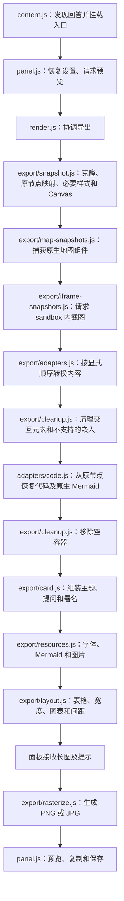

# 导出架构

> English: pipeline notes for turning one ChatGPT answer into a static image. The sections below are in Chinese. The preview panel calls `createCard()` and `rasterize()` only.

[English README](../README.md) · [简体中文 README](../README.zh-CN.md)

本项目把 ChatGPT 单条回答的当前内容和交互状态转换为静态长图。组件兼容逻辑与面板、资源加载、排版和图片输出分别维护。

## 处理流程



## 模块边界

| 模块 | 职责 | 约束 |
| --- | --- | --- |
| `chatgpt/selectors.js`、`dom.js` | 回答、提问、生成状态及操作栏识别 | 宿主回答选择器集中维护；组件内部选择器归相应适配器 |
| `render.js` | 编排导出阶段 | 不添加组件选择器或具体控件转换逻辑 |
| `export/snapshot.js` | 建立 DOM 副本及来源映射；捕获可读取的 Canvas 和数学／SVG 样式 | 不修改原回答；过滤判断基于原 DOM |
| `export/iframe-snapshots.js`、`frame-capture.js` | 在 sandbox 内栅格化当前可视化，再替换副本中的 iframe | 域名、消息来源和请求 ID 校验；不修改原页面；失败沿用嵌入提示 |
| `map-buffer.js`、`export/map-snapshots.js` | 在地图初始化时保留 WebGL 绘制缓冲，导出时把整个地图组件转成 PNG | 仅匹配原生 Mapbox 地图；检查透明缓冲；不移动地图或修改源 DOM |
| `export/adapters.js` | 固定适配顺序 | 适配器在清理按钮前读取原节点的实时属性 |
| `export/adapters/` | 把内容转换为静态 DOM | 不操作面板、不保存设置、不下载资源 |
| `export/cleanup.js` | 移除不应导出的节点、替换嵌入及清理空容器 | 必须保留适配器产生的静态内容 |
| `export/card.js` | 组装长图外观 | 接收转换后的内容，不识别宿主组件 |
| `export/resources.js` | 等待字体、渲染 Mermaid、解码及内联可导出图片 | 保留原有超时与失败提示 |
| `export/layout.js` | 编排已有布局策略 | 测量已挂载且资源已准备的长图 |
| `export/rasterize.js` | 栅格化、倍率限制、圆角与输出格式 | 不修改源回答或导出偏好 |
| `shared/` | 公共颜色判断、选择标记及超时 | 不依赖面板或组件适配器 |
| `styles/` | 长图样式 | 通过 `card.js` 按固定顺序合并；无运行时 CSS 网络请求 |

`src/layout.js` 保存设置校验、宽度限制和测量策略；`src/export/layout.js` 负责在导出阶段调用这些策略。

`src/review-invite.js` 单独保存本机 `reviewInviteShown` 标记，不混入导出设置；面板只在手动切换署名开关后请求展示，初始化恢复设置不触发。存储失败时保持开关可用，并在当前页面内抑制重复邀请。

当前 140 项自动化测试通过。评价邀请已通过本地浏览器桌面及 390px 窄屏检查，包括关闭、重新切换及刷新后不再提示；真实 ChatGPT 页面与商店评价页跳转仍待重载扩展后验收。

## 接口与状态

面板继续只调用以下接口：

```js
createCard(answer, options, mount) // Promise<{ card, warnings }>
rasterize(card, options)          // Promise<{ blob, layoutWidth, width, height, reduced }>
```

快照产生的上下文包括：

- `clone`：可修改的 DOM 副本。
- `sourceByCopy`：原副本节点到源节点的映射。
- `omitted`：依据源 DOM 判定排除的节点集合。
- `options`：本次渲染的设置。
- `warnings`：沿用现有本地化提示字符串，最终去重。
- `readStyle`：读取原节点计算样式；测试可以注入替代实现。

原节点只读。`sourceByCopy` 初始涵盖克隆节点；适配器替换外层节点后，如果后续阶段还需要读取原布局，必须为替换节点补充来源映射。其他新生成的静态节点没有来源映射，后续适配器应跳过或按导出标记处理。上下文随单次导出释放，不缓存对话内容。

控件当前值仍在同步适配阶段从原节点读取，Canvas 在克隆时捕获。它们不构成可持久化或完整离线重放的 UI 状态模型。

## 适配顺序与节点归属

1. 公式卡片：把包含 `data-assistant-math-rendered` 的可视化按钮转为静态公式卡片，避免被按钮清理误删。
2. Writing block：在表单处理前将富文本编辑内容转换为静态 section。
3. 测验选项：将成组 pressable 转为静态答案行，保留反馈图标和来源映射。
4. 图标与视觉元素：在新表单 SVG 出现之前识别宿主图标。
5. 表单和清单：先转换表单选择项与输入值，再处理剩余的勾选控件，避免重复标记。
6. 结构化布局：保留卡片、行、网格、进度形状、实体文字及受支持组件布局。
7. 网络图片及图片占位：保留受支持的代理图片、比例、裁切和宽度，按图片开关处理。
8. 清理交互元素后，从原节点生成高亮代码或原生 Mermaid 图片；最后清理空容器。

代码转换在交互清理后从原节点读取内容，避免宿主工具栏或隐藏节点影响提取。数学／SVG 样式及 Canvas 捕获在快照阶段执行。

这是一组明确顺序的函数适配器，没有动态加载或自动优先级系统。新增组件时必须明确其节点归属及与现有步骤的关系。

结构化组件的对齐不能只归结为“居中”。`components.js` 为布局节点保留计算后的 `justify-content`、`align-items`、`align-self`、`justify-self`，为 text／title／caption 保留 `text-align`；计算样式覆盖语义属性时以实际源布局为准。`components.css` 为稳定的 `data-d-justify`、`data-d-align`、`data-d-text-align` 提供常用取值的回退。`visual-assets.js` 给未标记组件的图标行保留主轴和交叉轴对齐，不能只重建 flex-row 后任其靠起点排列。图片框的 margin-auto、SVG 整图居中、flex 主轴居中及文字居中是不同的布局约束，需分别验证。

## 混排卡片媒体

`components.js` 将只有媒体内容的裁切 box 识别为媒体容器，允许穿过无文本、单子节点的中性包装层；碰到含标题或其他内容的布局即停止。其 SVG／img SVG 表面标记为 `data-export-media`，保留来源声明的 width、max-width、aspect-ratio。该标记不按文案、列数或固定像素判断，也不接管普通独立图表。clip box 从源计算样式恢复裁切与圆角，包括 CSS 变量解析后的圆角。

`image-width.js` 跳过上述媒体表面的独立图表缩放，卡片内媒体不再缩到 85% 或叠加图表框；独立图表仍按 small／standard／large 缩放。`block-spacing.js` 不把组件内部图表框提升为正文块，局部间距交还组件。`network-images.js` 的图片表面只保留获准的照片节点，移除加载、操作及来源链接浮层，防止这些文字进入裁切流；外部标题／说明保留。

## 回答识别、代码与数学

`chatgpt/selectors.js` 同时支持旧的 `data-message-author-role`、登录后的 `data-content-search-unit-key`，以及未登录页面的 `data-message-role`。未登录回答只导出 `data-assistant-markdown-root`，提问读取 `data-user-message-copy`，入口挂在 `data-assistant-message-actions`。生成状态同时检查停止按钮、`data-message-complete` 与 `aria-busy`，属性变化触发重新扫描；对话框和菜单副本不参与回答发现。

`answerTitle()` 保留已命名对话标题；通用 ChatGPT 页面标题依次回退到回答标题、关联提问和 `ChatGPT-answer`。Writing block 单独导出优先使用编辑器标题。

`code-block.js` 识别标准 `pre`、`data-markdown-copy="code-block"`，以及同时具有直属 `data-message-content-controls` 和 `pre` 的代码外壳。替换整个外壳以去掉工具栏和重复语言行，语言属性包括 `data-code-language`；最终标签仅在代码框内保留一次。

`snapshot.js` 保留 KaTeX／MathML／MathJax 的排版样式，并让颜色继承导出主题。`.katex` 与 `math` 外框恢复自动宽高，内部的分式、根号和上下标几何保持原排版；独立公式通过 `data-export-display-math` 居中并参与块间距。`formula-cards.js` 将公式启动按钮转换为静态边框卡片；纯公式卡片也可被识别为可导出的回答。

`scripts/html-to-image-fonts.mjs` 在构建时为 html-to-image 1.11.13 的字体格式匹配器重置 `lastIndex`，防止后续字体声明丢失 `src`。补丁匹配失败时停止构建，依赖升级后需重新审查。回归测试直接比较原库与补丁后的 regular／italic／bold 字体源，并验证重复导出。

## 共享控件样式

导出控件的 SVG 结构由适配器生成，外观统一放在 `src/styles/widgets.css`。不要在各转换分支中重复定义相同图标或追加局部样式覆盖。

- select 和日期选择器统一调用 `form-controls.js` 的 `dropdownArrow()`；新增下拉类控件也必须复用此函数，不使用文字字符 `⌄` 代替箭头。
- 箭头统一标记为 `svg[data-export-form-control=arrow]`，尺寸随字号缩放，颜色适配浅色／深色，垂直居中且右侧间距一致。
- 日期左侧图标单独标记为 `calendar`；日历定位规则不能匹配全部日期 SVG，避免覆盖右侧箭头。
- 中性进度填充使用 `data-export-progress-fill` 和导出主题前景色，与轨道保持可辨；彩色背景变量读取计算后的颜色，宽度继续保留原比例，包括 0%。
- 文本字段（input／select／date／textarea）及分段控件的容器／选项标记为 `data-export-form-text`，参与 SVG 中的自然宽高重排；文本字段通过 `data-export-width="100%"` 保留整行宽度。箭头、日历、滑块、刻度及单选／复选标记继续保留几何，不因文字重排改变尺寸。
- segmented-control 从自身或内层 radiogroup 的 `data-block`／`data-d-block` 保留整行布局意图。整行控件按实际选项数量等分、允许标签在各自宽度内换行撑高；非整行控件按内容排布，并在必要时换行。不按标签文案或固定选项数决定布局，不复制宿主滑动选中背景的像素宽度。选中状态继续读取当前 `aria-checked`。
- 表单布局显式声明的 `gap:0` 保留为 0，只有无法读取数值时使用默认 gap。

修改共享组件时，检查所有调用分支，并验证浅色、深色和窄宽度实际 PNG。现有测试检查 select／日期的箭头一致及日历图标独立保留；尚未设置禁止重复图标或文字箭头的构建检查。

## 添加组件支持

1. 在本机可选的 `samples/intelligent-ui/` 保存真实 DOM、状态说明、页面参考图和实际导出图；该目录不纳入 Git，构建与测试不依赖它。
2. 确定稳定的 `data-d-component`、原生标签或 ARIA 属性，不依赖生成的 CSS 类名。
3. 在 `export/adapters/` 添加转换函数；通过上下文读取原状态并生成带 `data-export-*` 标记的静态内容。
4. 在 `export/adapters.js` 注册适配器，并说明顺序与节点归属。代码类内容需要注意其独立转换阶段。
5. 在 `styles/` 添加必要样式。基础 → 组件 → 字号／间距 → 控件及后续组件规则的合并顺序需保持稳定。
6. 为状态丢失、重复转换或清理误删等风险增加有意义的测试；可将真实样本提炼成 `tests/fixtures/`。
7. 运行 `npm test`，再检查浅色、深色、窄宽度与交互后的实际 PNG。

测试维护约定见 [tests/README.md](../tests/README.md)。导出集成测试调用真实 `createCard()`，避免在测试内维护另一套阶段顺序。

仅采集样本不会自动接入测试。未知组件当前沿用既有通用清理行为。

## iframe 静态截图

`frame.js` 仅注入 `https://*.web-sandbox.oaiusercontent.com/*`，并在子 frame 中监听来自 ChatGPT 直接父窗口的请求。父端同时校验 iframe 窗口、精确 origin、协议及随机请求 ID；只接受有尺寸上限的 PNG data URL。图片留在单次导出的内存里，不写入 storage 或上传服务器。

快照之后、普通适配和清理之前，`preserveIframeSnapshots()` 将成功捕获的 iframe 副本换成 `img[data-export-iframe-snapshot]`。失败或 25 秒无回应则保留 iframe，让原清理阶段产生提示。源 iframe 不被替换、滚动或重载。

Skybridge 的全宽同源内层 iframe 会逐层读取实际文档（最多五层），避免只截到 sandbox 外壳；其他嵌套 iframe 无法捕获时明确失败。内部文档通过 html-to-image 生成 PNG，字体和原生图片等待就绪，像素总量上限 1600 万、数据长度上限 3200 万字符。该方案是 DOM 栅格化，受字体、资源访问和 Canvas/WebGL 可读取性限制，不保证任意网页的屏幕像素一致。

截图保持当前页面主题和排版，宽度随长图内容等比缩放。`applyImageWidths()` 跳过此标记，避免普通图表大小设置缩小整个页面。导出主题、字号不会改写截图内的内容。

## 原生地图截图

`map-route-gym-eligibility` 和 `ottawa-walking-tour-map` 的地图是主页面上的 `canvas.mapboxgl-canvas`，均没有 iframe。地图所属的 `[data-testid="businesses-map-widget"]` 由单独截图阶段处理，普通 Canvas 继续使用 `snapshot.js`。只调用 `toDataURL()` 未抛错不代表地图像素存在。

`map-buffer-entry.js` 在 ChatGPT 页面 `document_start` 的 MAIN world 运行，包装 `HTMLCanvasElement.getContext()`，仅当 Canvas 匹配 Mapbox 类名且属于 `chatgpt-map-canvas` 时，对 WebGL 请求开启 `preserveDrawingBuffer`。已创建的上下文不能靠后续导出改变这个选项，因此扩展更新后必须刷新对话。其他 Canvas 和参数保持原调用方式；不查找 React 私有状态、不滚动或缩放地图、不注册持续截图任务。保留缓冲存在性能代价，Mapbox 默认关闭此选项是性能优化，见 [Mapbox 文档](https://docs.mapbox.com/mapbox-gl-js/api/map/#map-parameters)。

地图截图在普通适配／按钮清理之前执行，避免编号按钮、`aria-hidden` 地点标签和卡片一起丢失。先在独立 2D Canvas 排除透明或纯黑的清空缓冲，再通过 html-to-image 栅格化整个组件；这不能证明所有瓦片已加载，仍需原页面视觉核对。不支持的交互提示及展开控件被过滤，同源 SVG sprite 引用转换为静态矢量形状。数据源仍是原页面，不重新请求地图瓦片或重建路线。

`scripts/html-to-image-scroll.mjs` 只在调用方设置 `preserveScrollPositions` 时，对克隆节点的子元素施加原滚动位置偏移，保留当前可见卡片和裁切范围。补丁在构建阶段应用，依赖升级时必须复查克隆流程；源节点不被滚动。

成功输出 `img[data-export-map-snapshot]`，不受普通图表大小设置影响。地点缩略图因 CORS／网络失败而无法内联时，`onImageErrorHandler` 只在 html-to-image 的克隆图片上写入自包含占位 SVG，保留地图截图并单独发出缩略图警告。源图片不改动。透明、不可读、必需资源失败或 15 秒超时则将整个地图组件替换为说明并发出警告；控制台记录捕获错误原因。像素量限制沿用 1600 万。地图需在原页面检查瓦片、路线、标记及地点缩略图；离线 DOM 或测试 WebGL 底色不能替代真实地图 PNG 验收。

## 构建与清理

构建先清空生成目录 `dist/`，再生成扩展资源，避免旧文件留在安装包中。源代码、本地样本和测试 fixture 不由构建删除。

浏览器临时输出使用 `output/playwright/` 或系统临时目录，提交前清理；正式样本放入 `samples/intelligent-ui/`，自动化回归所需 DOM 放入 `tests/fixtures/`。仅保留当前构建和已校验的当前发布包。版本、变更及验证历史通过 Git 查看，不新增历史副本或一次性验证报告。

## 结构化网络图片

`content-filter.js` 保留结构化 image 组件内的 `https://images.openai.com/static-rsc-*/...` 图片，继续排除生成图片和 favicon。`network-images.js` 将 authored aspect-ratio、width、max-width 和 object-position 转换到导出节点，移除 loading UI；这些图片不受图表尺寸设置影响。

`shared/network-image.js` 通过 runtime 消息向 `image-worker.js` 请求图片。worker 校验发送方为 ChatGPT 主 frame、URL 为唯一允许的 HTTPS 域名及 static 图片路径；匿名无 referrer 请求，禁止重定向，接受 PNG/JPEG/WebP/GIF/AVIF，流式限制 10 MiB，超时 12 秒。收到的 data URL 仅留在当前导出内存，正文图片解码后限制 1600 万像素；失败时仍显示图片占位并警告。地图截图通过 scripts/html-to-image-resources.mjs 的构建补丁传入受限 resourceLoader，复用相同后台通道；每次捕获内按完整 URL 复用结果，读取失败转换为占位并记录界面警告，其他资源保留库的原有行为。

新增 host permission 仅为 `https://images.openai.com/*`。构建输出 image-worker.js 并在 manifest 注册 service_worker；隐私政策说明资源请求、权限和临时数据。显示图片开关以 showImages 存储，兼容旧 showImagePlaceholders 偏好；关闭时在资源读取前移除正文照片／占位及地图卡片照片，但地图底图、标记、图表和 iframe 可视化保留。

## Writing block 适配

`export/adapters/writing-blocks.js` 在普通表单转换之前识别 `[data-oai-writing-block-surface]`／`[data-testid="chatgpt-writing-block"]`，将多行 textbox 编辑器的已快照子节点移动到静态 section。保留 h1/h2、段落、列表、strong、行内 code 和现有来源映射，不使用可能滞后的 data-markdown-copy-text 重建内容。外层编辑 UI、role=textbox 和编辑属性不进入输出；普通输入框继续走表单适配。

`styles/writing-blocks.css` 使用自动高度和标准边框，块间距复用 data-export-flow；内容跟随导出宽度、字体和主题排版，不复制原编辑器的固定高度，也不通过裁切隐藏末尾。正式 Writing block fixture 覆盖语义内容、尾随正文和源 DOM 不变。

区块单独导出：`content.js` 在已完成回答中识别 Writing surface，通过 header 内原生 Copy 的祖先找到工具栏，将“导出此区块 / Export block”放在复制按钮左侧。入口按区块去重，工具栏替换后重新挂载；流式生成或区块移除后清理。surface 和 editor 选择器统一定义在 `chatgpt/selectors.js`，对话框／菜单中的副本不添加入口。

区块入口与回答入口共用 `entry.css` 的无边框 hover／聚焦样式；区块按钮最小高度 36px，与原生工具栏对齐，不添加回答入口的左侧分割线。区块按钮用 `role=tooltip` 与 `aria-describedby` 关联提示，hover／focus-visible 以零延迟 CSS 显示“将此区块导出为格式化长图”；不使用原生 title。Export image 不显示提示。

`openPanel(answer, { writingBlock })` 验证区块仍属于指定回答，使用该 surface 作为 `createCard()` 的源节点；Writing 适配器也支持快照根本身为 surface。仍从当前编辑器读取语义内容，沿用相同的资源、布局和栅格化流程。面板标题明确当前为区块导出，文件名优先取区块标题；隐藏“包含提问”，仅对本次渲染关闭 prompt，不覆盖已保存偏好。区块消失时报告 conversationChanged，禁止回退导出整条回答。

## 栅格化时的文字重排

结构化布局的 `data-d-has-width` 不限于图形。`components.js` 保留带此标记的组件所声明的宽度，并通过 `data-export-width` 记录尺寸意图，如日程的 100px 时间栏、百分比／em 列和 `max-content` 行内文字组；不按文案、日期或固定列数识别布局，也不把文字列标记成固定高度图形。`styles/components.css` 支持小字号 `sm`／`xs`／`2xs`／`3xs`；有显式宽度的行内文字组使用 inline-block，保留与图标的分组。嵌套组件卡片使用父容器 gap，`typography.css` 取消其重复外边距。

普通 DOM 与 SVG image 的文字度量可能不同。已复现同一段正文在 DOM 中占两行、转图片后占三行；html-to-image 复制的固定段落高度导致后续文字覆盖。仅取消库的字号缩小处理未能消除此例。

`rasterize.js` 先使用 html-to-image 内联资源并生成 SVG，再由 `svg-layout.js` 在独立的序列化副本中恢复段落、标题、列表、代码块、表格单元格、文本控件及其祖先容器的自然高度；含文字的网格行也恢复自动高度。图形、数学、图片框、进度形状及几何控件保留自己的尺寸。源回答和暂存卡片均不修改。

文字流及祖先容器在 SVG 副本中恢复自然宽度，范围包括 row、居中的 column、grid-item 及普通多层 div／span。只处理 row 直接文本的旧规则覆盖不足：同样的冻结宽度会让统计标签或嵌套链接的箭头多换一行。现在优先恢复 `data-export-width` 中的声明值，其余按 `width:auto` 参与正常布局；长文仍可换行。卡片根宽度、表格及其列／单元格保留布局阶段的几何，图形与几何控件继续排除在文字重排之外；带 `data-export-form-text` 的静态文本控件可以重排。

组件内部的标题和分隔线统一由组件 gap／局部 margin 控制，不能再标记成正文 `data-export-flow` 叠加大间距；这一判断穿过普通包装层，适用于 box、row、grid、grid-item、form、radio-group、list、list-item 及表单布局。组件内 hr 使用局部 4px × 间距倍率，独立正文分隔线继续使用 18px × 间距倍率，源条目的 padding 保留。

组件内部标题／统计数字由组件的 gap 控制间距，`preserveBlockSpacing()` 不再只排除 row 内标题，而是同时排除 box／grid／grid-item 等组件中的标题；普通正文标题继续使用块间距。

清单文字并不总在段落内。`svg-layout.js` 同时识别含非空直接文本节点的元素，将 label／span／普通 div 及其祖先纳入自然高度重排；仍在图形与静态控件边界内跳过。`typography.css` 让清单行的直接 label 使用剩余宽度并允许收缩，避免文字按内容宽度收窄后被 SVG 克隆冻结。

SVG 在图片上下文中以低分辨率探测实际内容结束位置；双色标记在最终渲染前移除。探测空间不足时在既有画布轴长／像素限制内扩大重试，最终按测得高度重新计算导出倍率并生成 PNG／JPG。不能确认结束位置或超出限制则报错，不按旧 DOM 高度裁切。此流程增加一次 SVG 图片解码和低分辨率绘制，不涉及网络上传。

## 回答下方的导出入口样式

`src/entry.css` 统一控制 `button[data-answer-imagifier=export]` 的外观：32px 最小高度、8px 圆角、默认透明且无边框，hover／focus-visible 显示底色；键盘聚焦保留清晰轮廓。左侧 1×16px 分割线使用按钮的伪元素，位于 hover 表面之外，并随按钮一起换行和移除，不额外插入分割线节点。颜色跟随当前文字颜色适配主题。

`content.js` 只负责挂载入口与点击行为，不再用鼠标事件修改背景。宽度保持 max-content，避免宿主将带文字的入口压成图标宽度。本地浅色／深色、窄宽度、真实 hover 与键盘聚焦已检查；安装后的 ChatGPT 页面需重载扩展并刷新后复验。

## 嵌套 checkbox 标签布局

`checklist.js` 优先寻找包裹控件的 label，或按 id／for 匹配关联标签所在的最近共同容器，再回退到结构化 row。通过比较属性值避免特殊字符 ID 的选择器转义问题。静态清单行标记放在实际包含标记和文字的容器，确保横向 flex、标签收缩换行与 SVG 尺寸规则能作用于正确子节点；li 列表的独立路径保持不变。

## 固定尺寸容器与图形底色

`data-export-shape` 只承担固定几何、无收缩和裁切，不强制 display:block，不改变组件原有 flex／grid 布局。仅无文本及 SVG／img／canvas 的图形另标记 `data-export-shape-paint`，沿用主题轨道默认底色；中性进度填充的 currentColor 回退保持。含内容的容器保留来源背景变量的计算值，包括透明和中性色，避免原本透明图标盒被替换成灰块。

## 目录

- `src/content.js` / `src/dom.js`：回答识别、生成状态及导出入口；宿主回答选择器集中在 `src/chatgpt/selectors.js`。
- `src/panel.js` / `src/settings.js`：预览面板、导出操作及本机偏好。
- `src/render.js`：导出流程协调，保留 `createCard()` / `rasterize()` 接口。
- `src/export/`：快照、适配器顺序、清理、长图组装、资源加载、布局及图片输出。
- `src/export/adapters/`：结构化布局、表单、清单、图标、图片占位和代码块的静态转换。
- `src/shared/`：适配器共用的勾选标记、颜色判断及异步超时。
- `src/code-block.js` / `src/code-language.js` / `src/math-style.js`：代码与数学内容处理。
- `src/layout.js` / `src/table-layout.js` / `src/image-width.js` / `src/block-spacing.js`：排版策略与测量。
- `src/styles/`：长图基础、组件、字号／间距和控件样式；按固定顺序合并到 Shadow DOM。
- `src/panel.css`：面板样式。
- `samples/intelligent-ui/`：本机可选的真实样本、参考截图与导出对照，已由 Git 忽略；构建与测试不依赖此目录。
- `tests/fixtures/`：自动化测试使用的精简 HTML。
- `public/manifest.json`：Chrome Manifest V3 配置；ChatGPT 页面入口和 sandbox iframe 截图脚本分别匹配指定域名，API 权限为 storage，另需 `https://images.openai.com/*` 的网络图片访问权限；后台只接受 ChatGPT 主页面的指定图片路径请求。

实现参考：[Chrome 内容脚本文档](https://developer.chrome.com/docs/extensions/develop/concepts/content-scripts)、[html-to-image 项目文档](https://github.com/bubkoo/html-to-image)。

## 验证边界

自动化测试调用真实 `createCard()` 管线，浏览器验证实际 SVG／PNG 输出。当前 134 项测试通过；基于未登录结构的本地回放在 640 px / Large / 2× 下输出完整公式卡片、独立公式、表格、代码和列表，无横向溢出。建议加宽布局的提示与实际溢出检测分别维护。

原 demo 会话重载扩展后的验收、偶发字形重叠，以及部分深色混排 SVG 空白仍待复验。本地受控结构的输出不等于真实 ChatGPT 页面逐像素一致。当前待办统一维护在中文 README，不保留独立历史报告。
